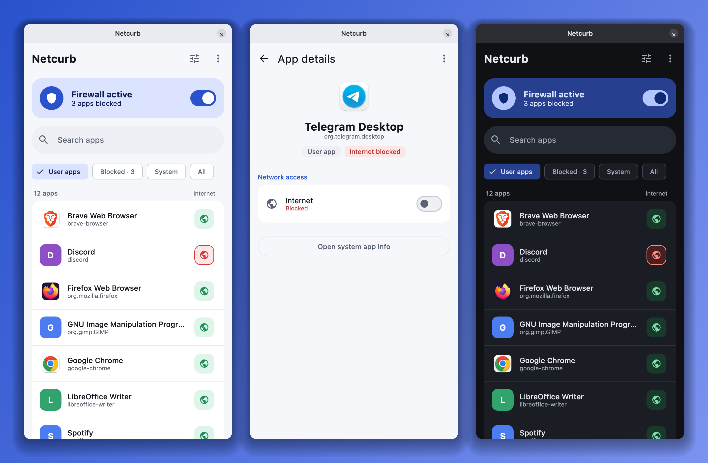
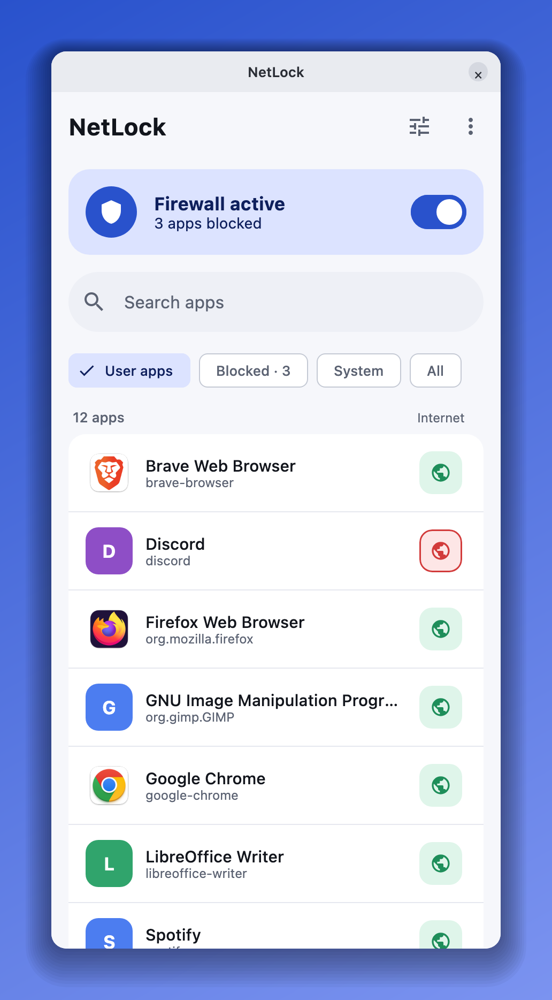
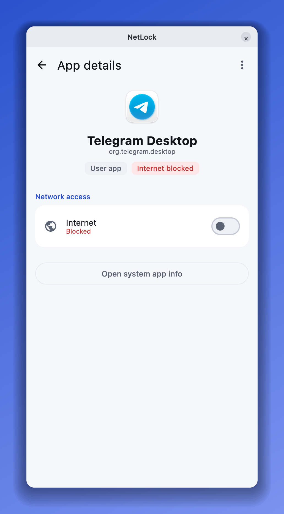
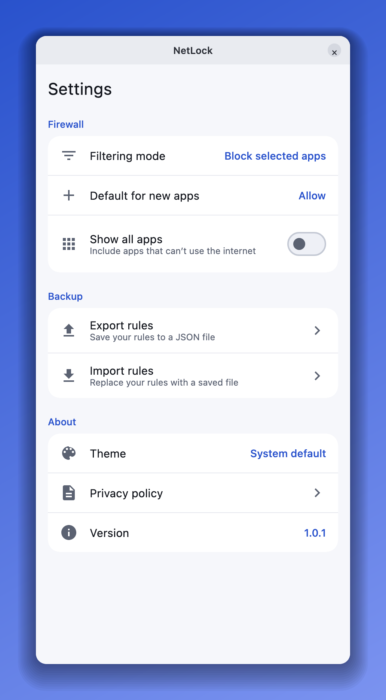
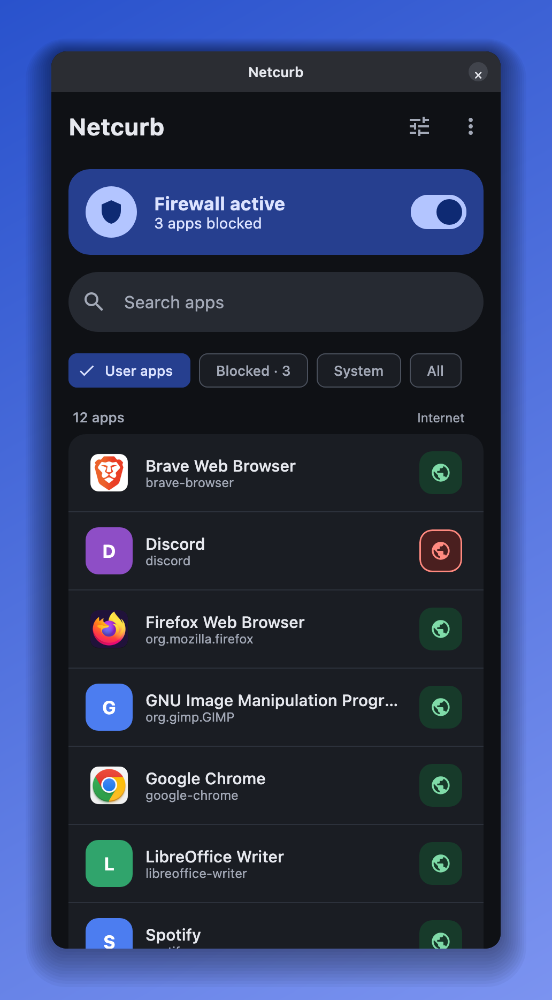

<p align="center">
  
</p>

<h1 align="center">NetLock</h1>

<p align="center">
  <b>Per-app internet firewall.</b> One switch per app: blocked apps can't reach the internet.<br>
  No account · no ads · no analytics · no data collected
</p>

<p align="center">
  <a href="https://github.com/iamanwaralam/netlock-releases/releases/latest"></a>
  <a href="https://github.com/iamanwaralam/netlock-releases/releases"></a>
  
</p>

<p align="center">
  
</p>

## Download

| Distribution | Package |
|---|---|
| Ubuntu 24.04+, Debian 13+, Kali, Linux Mint 22+, Pop!_OS 24.04+ | [**netlock_1.0.1_amd64.deb**](https://github.com/iamanwaralam/netlock-releases/releases/download/linux-v1.0.1/netlock_1.0.1_amd64.deb) |
| Fedora, RHEL / Rocky / Alma 9+ | [**netlock-1.0.1-1.x86_64.rpm**](https://github.com/iamanwaralam/netlock-releases/releases/download/linux-v1.0.1/netlock-1.0.1-1.x86_64.rpm) |
| Arch, Manjaro, EndeavourOS | [**netlock-1.0.1-1-x86_64.pkg.tar.zst**](https://github.com/iamanwaralam/netlock-releases/releases/download/linux-v1.0.1/netlock-1.0.1-1-x86_64.pkg.tar.zst) |

All versions and checksums: [Releases](https://github.com/iamanwaralam/netlock-releases/releases).
**Android** is coming to Google Play, **Windows** soon, and **macOS** later.

## Features

- 🧱 **One switch per app.** Block or allow internet access for each app you have installed.
- 🖥️ **Your real apps, with icons.** Every app in your menu, including Snap and Flatpak. System tools are listed separately.
- 🔒 **Stays on.** Blocking keeps working when NetLock is closed and after a reboot.
- 👤 **Only you change the rules.** Other users on the same computer can't unblock your apps.
- 🌙 **Light and dark theme**, plus search and filters (user apps, blocked, system).
- 🧹 **Clean uninstall.** Removing NetLock also removes its firewall rules and background service.
- 🕵️ **Private.** NetLock makes no network requests of its own and never inspects your traffic.

## Screenshots

| App list | App details | Settings | Dark mode |
|:-:|:-:|:-:|:-:|
|  |  |  |  |

## Install

Download the package for your distribution, then:

```sh
sudo apt install ./netlock_1.0.1_amd64.deb            # Ubuntu, Debian, Kali, Mint, Pop!_OS
sudo dnf install ./netlock-1.0.1-1.x86_64.rpm         # Fedora, RHEL, Rocky, Alma
sudo pacman -U ./netlock-1.0.1-1-x86_64.pkg.tar.zst    # Arch, EndeavourOS, Manjaro
```

Optional: check the download with `sha256sum -c SHA256SUMS --ignore-missing` (`SHA256SUMS` is on the release page).

## How to use

1. Open **NetLock** from your app menu.
2. Tap the switch next to an app so it turns red, then turn the firewall **on**.
3. Enter your password **once**. A small background service applies your rules from then on.
4. Close the app you blocked and open it again **from the menu or dock**. It now has no internet; everything else
   works as before.

To allow an app again, tap its switch, or turn the firewall off.

## Requirements

- x86_64 PC with **systemd** and **cgroup v2** (standard on current distributions)
- **GNOME** or **KDE Plasma** desktop, on X11 or Wayland
- `nftables` and `pkexec` (installed automatically with the package)

## Good to know

- **Restart an app after blocking it.** Connections it already opened can stay up until then.
- **Start blocked apps from the menu or dock.** Apps started from a terminal aren't blocked.
- **XFCE, MATE, Cinnamon and LXQt** aren't supported yet. NetLock installs there, but it can't block apps.
- **Not available yet:** an ARM build, and packages for Ubuntu 22.04 or Debian 12.

## Uninstall

```sh
sudo apt remove netlock      # or: sudo dnf remove netlock / sudo pacman -R netlock
```

This also removes NetLock's background service and firewall rules. Your list of blocked apps is kept in
`~/.local/share/NetLock`; delete that folder to remove it too.

## Privacy

NetLock works entirely on your computer. It has no accounts, analytics or ads, makes no network requests of its own,
and doesn't inspect, log or send your traffic. Read the
[privacy policy](https://techsavvyhelp.com/netlock-privacy-policy/).

## Feedback

Found a bug or have an idea? [Open an issue](https://github.com/iamanwaralam/netlock-releases/issues). Please include
your distribution, your desktop (GNOME or KDE) and what happened.

---

<sub>© 2026 TechSavvyHelp. NetLock is free to use. Screenshots show example apps.</sub>
